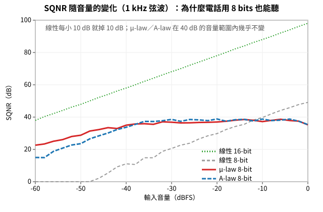
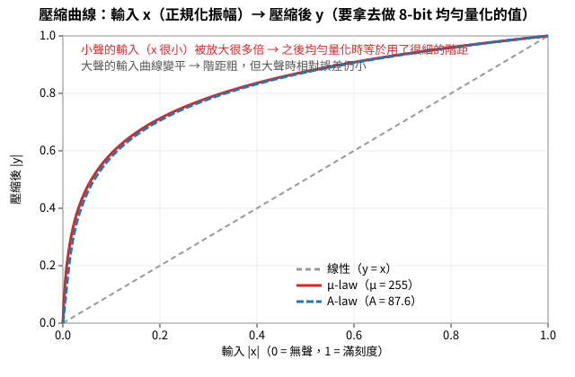
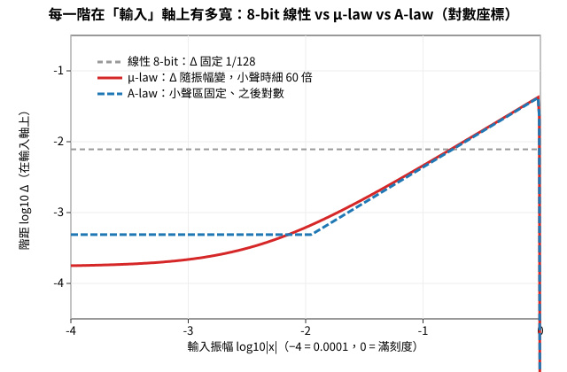
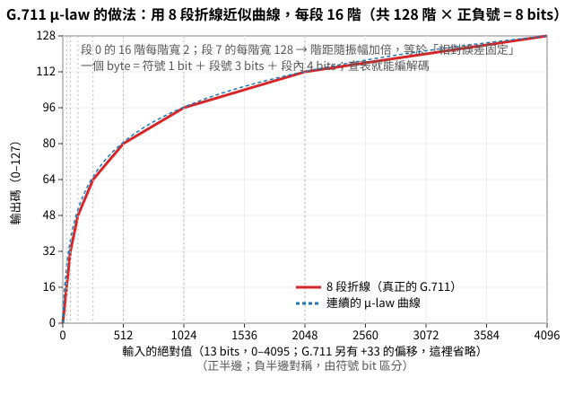
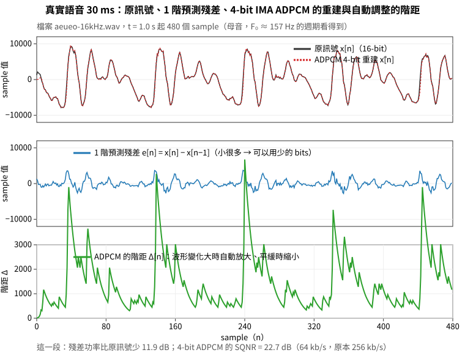
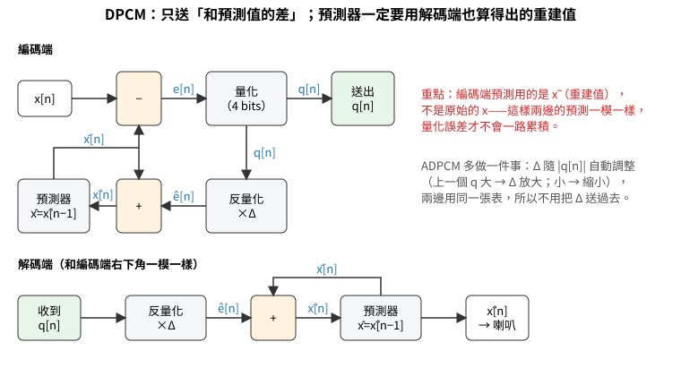
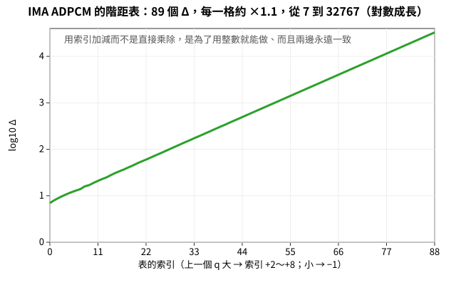

# 語音編碼的方法（配合 Team 2 功能 4；課後讀，11/16 討論會前看完）

> 原本排在 11/2 第二、三節，改為課後讀：第 2.1–2.3 節是 μ-law 與 DPCM 的原理（Team 2 的 `--codec mulaw` 就是 2.2），後面是延伸。範例：[examples/mulaw_demo.py](examples/mulaw_demo.py)、[examples/dpcm_demo.py](examples/dpcm_demo.py)。

## 圖解：μ-law、A-law、ADPCM（淺顯版，先看這裡）

這三個是「把聲音的位元率減半或減四分之一」最老、最簡單、至今還在電話裡用的方法。先用圖看懂，公式放後面。
圖都是 [examples/make_codec_figs.py](examples/make_codec_figs.py) 當場算出來的，可以自己改參數重畫。

### 1. 問題：8 bits 直接量化，小聲的時候會很難聽

第 3 週學過：16-bit 的 sample 有 65 536 階，階距很細。如果為了省一半的位元率改成 8 bits，階距一下子粗 256 倍。
大聲的時候還好（訊號大、誤差相對小），**小聲的時候訊號只用到幾個階，誤差相對就很大**——講話的句尾、停頓前後都是小聲的，聽起來沙沙的。

下圖是用 1 kHz 弦波實測的 SQNR（訊號比量化雜訊，越高越好）：灰線「線性 8-bit」每小聲 10 dB 就掉 10 dB，到 −40 dBFS 只剩 11 dB，根本不能聽。



### 2. 解法：先「壓」再量化——μ-law 與 A-law

想法很直覺：**小聲的先放大、大聲的先壓小，再用 8 bits 均勻量化；解碼時反過來展開。**
這樣小聲的訊號等於用了很細的階距，大聲的用粗的階距，「相對誤差」差不多，SQNR 就不再隨音量掉（上圖的紅線、藍線在 −40 到 0 dBFS 之間都是 35–39 dB）。

壓縮用的曲線就是對數曲線，北美與日本用 **μ-law**（μ = 255），歐洲與台灣用 **A-law**（A = 87.6），形狀幾乎一樣：



把曲線換個角度看——「輸入每一階有多寬」：線性 8-bit 固定 1/128；μ-law 在小聲處細到 1/8000 左右，大聲處才放寬到 1/50。這就是「小聲細、大聲粗」。



真正的電話標準 **G.711** 不算對數，而是用 **8 段折線**近似：每段 16 階，每一段的階距是前一段的兩倍。一個 byte = 1 bit 符號 + 3 bits「第幾段」+ 4 bits「段內第幾階」，編解碼各一張 256 格的表就完成，一個 sample 幾個時脈週期。



| | 線性 16-bit | 線性 8-bit | μ-law／A-law 8-bit |
|---|---|---|---|
| 位元率（16 kHz） | 256 kb/s | 128 kb/s | **128 kb/s** |
| 滿刻度時 SQNR | 98 dB | 49 dB | 35 dB（大聲時比線性 8-bit 差） |
| −40 dBFS 時 SQNR | 58 dB | 11 dB | **35 dB**（這就是重點） |
| 做法 | 原樣 | 丟掉低 8 bits | 查表 |

公式（想知道的再看）：

```
μ-law 壓縮  y = sign(x) · ln(1 + μ|x|) / ln(1 + μ)          μ = 255，x、y 都在 [−1, 1]
      展開  x = sign(y) · ((1 + μ)^|y| − 1) / μ
A-law 壓縮  y = sign(x) · A|x| / (1 + ln A)                 |x| < 1/A（小訊號：直線）
            y = sign(x) · (1 + ln(A|x|)) / (1 + ln A)        其餘（對數）             A = 87.6
```

**和 Team 2 的關係**：功能 4 的 `--codec mulaw` 就是這件事——送端每個 16-bit sample 查表變 1 byte（一包 320 bytes），收端查表變回 16-bit，再交給 jitter buffer；PLC（packet loss concealment，封包遺失補償） 一行都不用改。

試試看：

| macOS / Linux / WSL | Windows PowerShell |
|---|---|
| `python3 examples/mulaw_demo.py ../wk07_1019_audio-pcm/data/speech_osr_16k.wav` | `python examples\mulaw_demo.py ..\wk07_1019_audio-pcm\data\speech_osr_16k.wav` |

### 3. 再省一半：只送「差多少」——DPCM 與 ADPCM

語音的相鄰兩個 sample 很像（它是低頻為主的訊號）。那就不要送 x[n] 本身，送 **x[n] 和「猜測值」的差**；最簡單的猜測是「跟上一個一樣」。差值比原值小很多，用 4 bits 就夠，位元率再減半（64 kb/s）。

下圖是真實語音的 30 ms：上面是原訊號與 4-bit ADPCM 重建出來的（幾乎疊在一起），中間是「差值」（比原訊號小很多，功率少 12 dB），下面是 ADPCM 自動調整的階距。



方塊圖只有一個地方要注意：**編碼端的「猜測」要用解碼端也算得出來的「重建值」x̃，不能用原始的 x**。否則兩邊猜的不一樣，誤差會一路累積（這和 Team 2 的 PLC `repeat` 只能重複「收端手上有的」frame 是同一個道理）。



**DPCM 的困擾**：差值用固定階距 Δ 量化——Δ 太小，波形突然變大時跟不上（slope overload）；Δ 太大，平緩處粗糙（granular noise）。
**ADPCM（adaptive）的解法**：Δ 跟著訊號自動調：上一個差值很大 → 下一個 Δ 放大；很小 → 縮小。兩邊用同一張表、同一個規則，所以 Δ 不用送。IMA ADPCM 的表有 89 格，每格約 ×1.1：



| | 線性 16-bit | μ-law 8-bit | ADPCM 4-bit（G.726 32 kb/s 等級） |
|---|---|---|---|
| 位元率（16 kHz） | 256 kb/s | 128 kb/s | **64 kb/s** |
| 語音實測 SQNR | ≈ 83 dB | ≈ 38 dB | ≈ 25 dB（夠聽） |
| 掉一個封包會怎樣 | 沒影響下一包 | 沒影響下一包 | **預測器失步**：解碼端的 x̃ 和編碼端對不上，之後的聲音都錯，直到重新同步 → Team 2 的做法是每個 20 ms frame 獨立編碼（預測器每包歸零），掉包只壞那一包 |

試試看：

| macOS / Linux / WSL | Windows PowerShell |
|---|---|
| `python3 examples/dpcm_demo.py ../wk07_1019_audio-pcm/data/speech_osr_16k.wav` | `python examples\dpcm_demo.py ..\wk07_1019_audio-pcm\data\speech_osr_16k.wav` |

### 4. 一張表記住三個方法

| 方法 | 一句話 | bits／sample | 要傳什麼額外資訊 | 誰在用 |
|---|---|---|---|---|
| 線性 PCM | 原樣 | 16 | 無 | WAV、CD、Team 2 的 pcm |
| μ-law／A-law | 小聲放大再量化（查表） | 8 | 無（表是固定的） | 電話 G.711、Team 2 的 mulaw |
| ADPCM | 只送差值、階距自動調 | 4（或 2、3、5） | 無（規則是固定的） | G.726、舊的 VoIP、遊戲音效 |

再往下壓（Opus 的 6–40 kb/s）就要「送參數」或「送感知得到的」——下面的延伸閱讀。

---

## 從 256 kb/s 往下壓

### 2.1 不壓縮要多少？Team 2 的封包開銷

| 項目 | 數字 |
|---|---|
| Team 2 的 PCM | 16 000 sample/s × 16 bits = **256 kb/s** |
| 每 20 ms 一包 | 640 bytes PCM ＋ 12 bytes header ＋ UDP 8 ＋ IP 20 ＋ 乙太網路 14 = 694 bytes → 50 包/s → **277.6 kb/s**；開銷 8.4% |
| 電話（G.711） | 8 kHz × 8 bits = **64 kb/s**；同樣 20 ms 一包只有 160 bytes，開銷 25% |
| Opus（LINE、Discord、WebRTC） | 語音 **6–40 kb/s**；20 ms 一包只有 15–100 bytes，header 比資料還大 |

兩個觀察：(1) 封包的固定開銷（54 bytes）不會隨壓縮變小，所以**壓得越兇，framing 的設計越重要**（這是為什麼 RTP header 只有 12 bytes，而且 Opus 不會把 frame 切更短）。(2) 壓縮是為了**位元率**（頻寬、行動網路的費用、同時通話的人數），不是為了「存起來」。

把 256 壓到 64、再壓到 8 kb/s，歷史上用了三種路線：**壓伸（量化階距隨大小變）→ 預測（只送差值）→ 參數／感知（送「怎麼合成」而不是波形）**。下面照這個順序。

### 2.2 壓伸（companding）：μ-law／A-law，為什麼 8 bits 能打電話

第 3 週 2.4 的結論：均勻量化的 SQNR ≈ 6.02n + 1.76 dB，但那是**滿刻度**的訊號。語音大部分時間是小聲的（母音之間、句子尾巴），小聲 30 dB 時 SQNR 也掉 30 dB——8-bit 線性量化在 −30 dBFS 只剩 8 dB，根本不能聽。

解法：**量化前先把訊號壓成對數曲線**，小訊號被放大、大訊號被壓縮，再做均勻量化；解碼端反過來展開。小訊號得到細的階距、大訊號粗的階距，**相對誤差差不多，SQNR 就幾乎不隨音量變**。

```
μ-law（北美、日本）  y = sign(x) · ln(1 + μ|x|) ／ ln(1 + μ)        μ = 255，x ∈ [−1, 1]
A-law（歐洲、台灣）   y = sign(x) · A|x| ／ (1 + ln A)                |x| < 1／A
                      y = sign(x) · (1 + ln(A|x|)) ／ (1 + ln A)     其餘，A = 87.6
```

G.711 把這條曲線用 8 段折線近似（每段 16 階），所以可以用查表做，一個 sample 幾個 cycle；13–14 bits 的線性 PCM 壓成 8 bits，**壓縮率 0.57–0.62，而且沒有延遲、沒有 frame**。這是第 3 週 2.3 講過的「非均勻量化」，也是期中考範例選擇題那個「G.711 是把 13–14 bits 壓成 8 bits」的出處。

| macOS / Linux / WSL | Windows PowerShell |
|---|---|
| `python3 examples/mulaw_demo.py` | `python examples\mulaw_demo.py` |
| `python3 examples/mulaw_demo.py ../wk07_1019_audio-pcm/data/speech_osr_16k.wav` | `python examples\mulaw_demo.py ..\wk07_1019_audio-pcm\data\speech_osr_16k.wav` |

實測（真實語音）：

| 音量 | 線性 8-bit | μ-law 8-bit |
|---|---|---|
| 0 dBFS | 35.0 dB | 37.9 dB |
| −20 dBFS | 15.6 dB | 36.5 dB |
| −40 dBFS | 1.4 dB | 26.5 dB |

線性 8-bit 每小 10 dB 就掉 10 dB；μ-law 在 40 dB 的音量範圍內只掉 11 dB。代價：滿刻度弦波時 μ-law（36 dB）比線性 8-bit（48 dB）差——它把「大聲時的精準」換成「小聲時還能聽」。

**和 Team 2 的關係**：11/1 起規格新增**功能 4：`--codec mulaw` 必做**（封包 type 0x04、一包 320 bytes、位元率減半，驗收第 10 項看 SQNR ≥ 30 dB）；ADPCM 是加分。做法就是audio_coding.md 的圖解：編碼一個查表（或這條公式）、解碼反過來；PLC 在解碼後的 16-bit 上做，完全不用改。

### 2.3 預測編碼：DPCM／ADPCM，只送「和上一個差多少」

語音是低頻為主的訊號（第 7 週 1.3：F₀ 100–250 Hz、能量集中在 4 kHz 以下），**相鄰的 sample 很像**。那就不要送 x[n]，送 **殘差 e[n] = x[n] − x̂[n]**，x̂[n] 是用前面的 sample 預測的值：

```
1 階：x̂[n] = x[n−1]                       （「跟上一個一樣」）
2 階：x̂[n] = 2x[n−1] − x[n−2]             （「照上一段的斜率直線外插」）
p 階 LPC：x̂[n] = Σ_{k=1}^{p} a_k·x[n−k]   （係數 a_k 每 20 ms 由訊號算一次——這就是下一節的 LPC）
```

殘差的功率比原訊號小多少（dB），叫 **prediction gain**；每小 6 dB 就能少用 1 bit 而 SQNR 不變。

| macOS / Linux / WSL | Windows PowerShell |
|---|---|
| `python3 examples/dpcm_demo.py ../wk07_1019_audio-pcm/data/speech_osr_16k.wav` | `python examples\dpcm_demo.py ..\wk07_1019_audio-pcm\data\speech_osr_16k.wav` |

實測（OSR 語音 16 kHz）：

| 送什麼 | 功率 | 熵（以 16-bit 值為符號） | prediction gain |
|---|---|---|---|
| sample 本身 | 63.0 dB | 11.78 bits/sample | — |
| 1 階殘差 | 48.0 dB | 8.72 bits/sample | 15.0 dB |
| 2 階殘差 | 43.4 dB | 7.84 bits/sample | 19.6 dB |

兩個讀法：
- **Huffman 的角度**（Team 1 的延伸）：熵從 11.8 降到 7.8 bits——同一支 Huffman 編碼器，先做預測再編，壓縮率從 0.74 變 0.49。「符號怎麼定」在聲音上就是「先不先預測」。這就是 FLAC 的原理（LPC 預測＋Rice／Huffman 編殘差，無失真，約 0.5–0.6）。
- **量化的角度**：殘差直接量化成 4 bits（**DPCM**），位元率 256 → 64 kb/s。程式試了四種階距：階距 256 時 SQNR 23.8 dB，太小（64）跟不上大的跳動（slope overload，9.4 dB），太大（512）小聲處粗糙（granular noise）。
  **ADPCM**（G.726，32 kb/s）讓階距跟著訊號自動調：上一個殘差大就把階距放大，小就縮小；預測器係數也邊跑邊調。

DPCM 最重要的一個細節（程式裡有註解）：**編碼端的預測器要用「解碼端重建出來的 x̂」而不是原始的 x**，否則兩邊的預測不同，誤差會一直累積。這和 Team 2 的 PLC `repeat` 是同一個問題：接收端用來「補」的，必須是它自己手上有的東西。

---

## 延伸閱讀：送參數、送感知得到的（課後讀）

### source–filter 模型與 LPC／CELP：為什麼語音 codec 都是 20 ms

第 7 週 1.3 講過：語音 = **聲源**（聲帶振動的脈衝串，週期 1/F₀；或氣音的雜訊）經過**聲道**（會變形的管子）濾波。聲道是一個 p 階的全極點濾波器，係數 a_k 由 20–30 ms 的 frame 算出（**LPC**，p ≈ 10–16）——和 2.3 的 p 階預測器是同一件事。
所以可以**不送波形，送參數**：每 20 ms 送一組 a_k＋F₀＋增益＋有聲／無聲，解碼端自己合成（LPC-10：2.4 kb/s，像機器人）。**CELP**（GSM、AMR、Opus 的 SILK）改成「聲源從一本 codebook 挑一個合成出來最像原音的向量」，只送索引。
**為什麼 20 ms**：LPC 假設 frame 內聲道不變；太短係數估不準、開銷大，太長聲道已經在變。Team 2 的 320 samples 就是語音 codec 的自然單位。

### 感知編碼：MP3／AAC 概觀

音樂沒有單一聲道模型，走另一條路：**不送人耳聽不到的部分**。每 frame（MP3：1152 sample）做 MDCT → 心理聲學模型算每個頻帶的**遮蔽門檻** → 門檻以下的粗量化、以上的細量化（雜訊藏在門檻下）→ Huffman。MP3 128 kb/s ≈ 壓縮率 0.09；是有失真壓縮，失真在量化但被遮蔽。

### 真實 codec 的 PLC、FEC、DTX

| 技術 | 做法 | Team 2 對應 |
|---|---|---|
| PLC：pitch 重複（G.711 App. I） | 重複上一個 pitch 週期、每包衰減、4 包後靜音 | `repeat` 的升級版；加分項「衰減」 |
| 接縫平滑 | 補的 frame 與前後做 2–4 ms cross-fade | 加分項「淡入淡出」 |
| FEC（Opus in-band） | 每包帶上一包的低品質版 | 多 20 ms 延遲、位元率多 20–30% |
| DTX／CNG | 沒人講話不送，收端合成輕微雜訊 | 「靜音」與「斷線」要分開 |
| 自適應 jitter buffer（WebRTC NetEQ） | buffer 隨量到的抖動自動調 | 報告第 2 題是手動版 |

